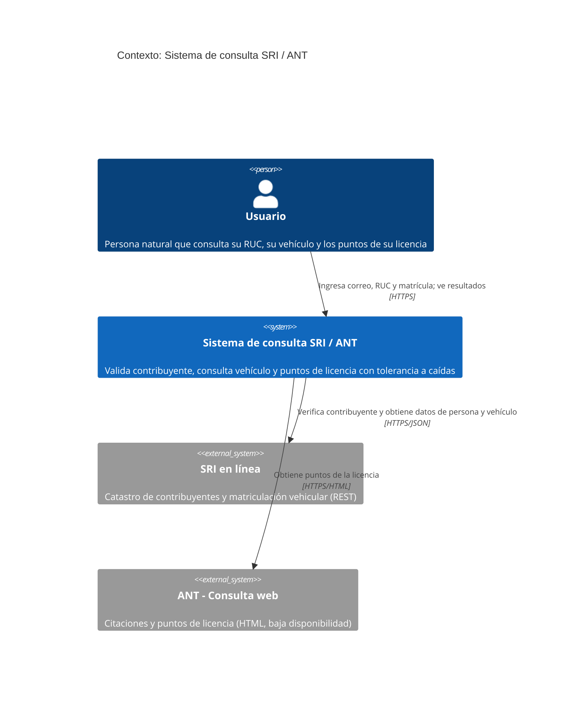
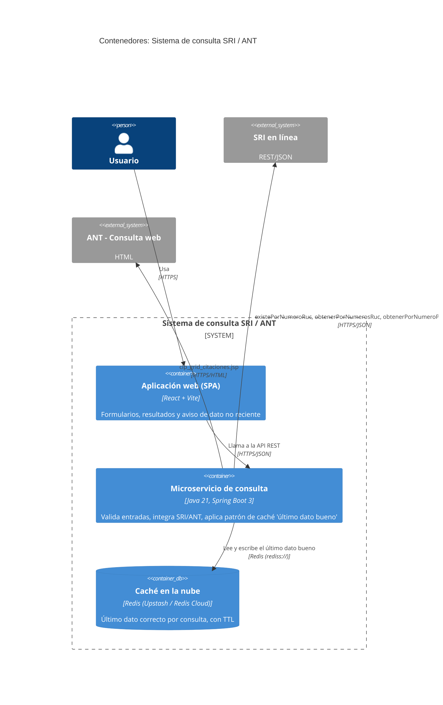
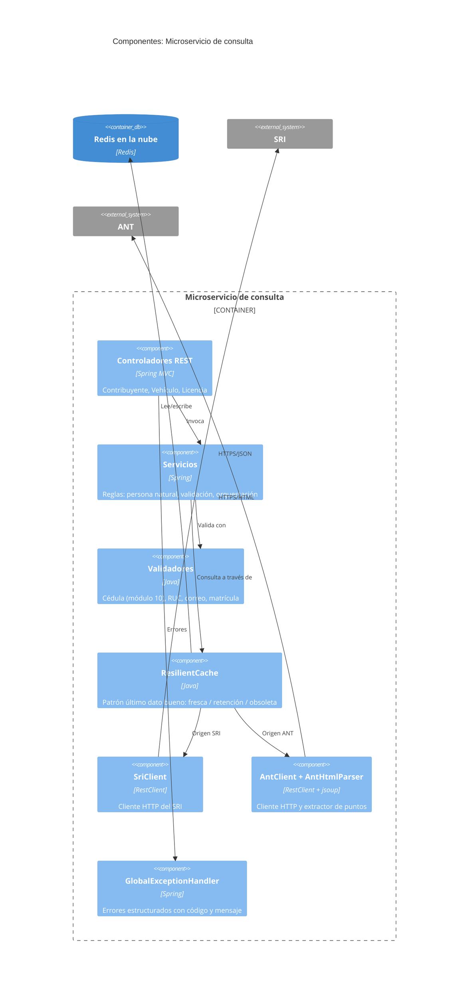

# Modelo C4 — Consulta SRI / ANT

Este documento es la fuente para construir el modelo en **icepanel.io**. Incluye los diagramas en Mermaid (GitHub los renderiza) y la lista exacta de objetos, conexiones y enlaces a cargar en IcePanel.

> Repositorio(s): sustituya `<ORG>` por su usuario/organización de GitHub.
> Un solo repositorio monorepo: `https://github.com/<ORG>/consulta-sri` (carpetas `backend/` y `frontend/`).

## Nivel 1 — Contexto

## Nivel 2 — Contenedores

## Nivel 3 — Componentes del microservicio (opcional, suma claridad)

## Carga en IcePanel (paso a paso)

1. Cree un **Landscape** nuevo: «Consulta SRI / ANT».
2. **Objetos** (Model → crear en este orden):

| Tipo | Nombre | Padre | Tecnología | Descripción |
|---|---|---|---|---|
| Actor | Usuario | — | — | Persona natural que consulta sus datos |
| Sistema | Sistema de consulta SRI / ANT | — | — | Sistema a construir |
| Sistema (externo) | SRI en línea | — | REST/JSON | Catastro y matriculación vehicular |
| Sistema (externo) | ANT - Consulta web | — | HTML | Puntos de licencia; baja disponibilidad |
| App | Aplicación web (SPA) | Sistema de consulta | React, Vite | Interfaz |
| App | Microservicio de consulta | Sistema de consulta | Java 21, Spring Boot | API REST + caché resiliente |
| Store | Caché en la nube | Sistema de consulta | Redis (Upstash) | Último dato bueno con TTL |
| Componente (nivel 3) | los 7 de arriba | Microservicio de consulta | ver diagrama | — |

3. **Conexiones** (Model → Connections), con *tecnología* y *descripción*:

| Origen → Destino | Tecnología | Descripción |
|---|---|---|
| Usuario → SPA | HTTPS | Usa la interfaz |
| SPA → Microservicio | HTTPS/JSON | Llama a `/api/v1/...` |
| Microservicio → Caché | Redis (TLS) | Lee y guarda el último dato bueno |
| Microservicio → SRI | HTTPS/JSON | Contribuyente y vehículo |
| Microservicio → ANT | HTTPS/HTML | Puntos de licencia |
| Usuario → Sistema (nivel 1) | HTTPS | Contexto |
| Sistema → SRI / ANT (nivel 1) | HTTPS | Contexto |

4. **Diagramas**: cree «Contexto» (nivel 1), «Contenedores» (nivel 2) y, si desea, «Componentes» (nivel 3). Arrastre los objetos y conexiones; IcePanel arma las flechas desde el modelo.
5. **Enlace a GitHub** (criterio de la rúbrica): en cada objeto → panel derecho → **Links** → *Add link*:
   - SPA → `https://github.com/<ORG>/consulta-sri/tree/main/frontend`
   - Microservicio → `https://github.com/<ORG>/consulta-sri/tree/main/backend`
   - Caché → `https://github.com/<ORG>/consulta-sri/blob/main/backend/src/main/java/ec/udla/sri/cache/ResilientCache.java`
   - Componentes (nivel 3) → el archivo correspondiente bajo `backend/src/main/java/ec/udla/sri/`.
6. **Enlace de lectura**: *Share* → activar enlace de solo lectura (view-only) → copiar y pegar en la entrega. **Ábralo en una ventana privada** para confirmar que funciona sin iniciar sesión (la rúbrica penaliza un enlace que no abre).
7. (Opcional, suma) **Flujo**: en *Flows* cree «Consultar puntos con ANT caída» con los pasos: SPA → Microservicio → Caché (lee) → ANT (falla) → Microservicio responde último dato bueno + aviso.
